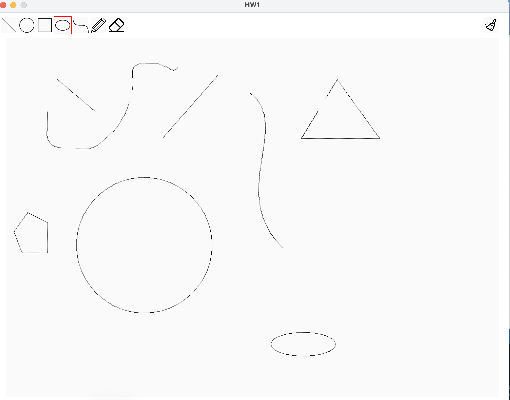

# CG Assignments - Lab 1

## 完成項目

| 項目 | 函式 | 狀態 |
|---|---|---|
| 直線演算法 | `CGLine` | ✅ 完成 |
| 圓形演算法 | `CGCircle` | ✅ 完成 |
| 橢圓演算法 | `CGEllipse` | ✅ 完成 |
| 貝茲曲線演算法 | `CGCurve` | ✅ 完成 |
| 橡皮擦 | `CGEraser` | ✅ 完成 |

所有圖形都只用 `drawPoint()` 一點一點畫出來，沒有使用 `line()`、`circle()`、`ellipse()`、`bezier()`、`rect()` 等禁止的內建函式。

## 執行截圖

畫面中使用了直線、圓、多邊形、橢圓、曲線、鉛筆，並用橡皮擦擦掉一部分。



## 實作方式

所有函式都寫在 `util.pde`。

### 1. 直線：Bresenham 演算法

螢幕上的像素都是整數格子，但真正的直線會經過小數位置，所以要決定每一步該塗哪一格。

做法是從起點一格一格走向終點，用一個誤差值 `err` 記錄目前和真正的直線差多少：

- 算出 x、y 方向總共要走的距離 `dx`、`dy`，以及要往正或負方向走（`sx`、`sy`）
- 每走一步，用 `err` 判斷這一步要往 x 走、往 y 走，還是兩個都走
- 走到終點就停

```java
int e2 = 2 * err;
if (e2 >= dy) { err += dy; x += sx; }
if (e2 <= dx) { err += dx; y += sy; }
```

整個過程只有整數加減，不需要乘除或小數，所以很快。這個寫法對任何方向、任何斜率的線都適用。

### 2. 圓：中點畫圓演算法

圓是對稱的，所以只要算出 1/8 個圓（從正上方走到 45 度），其他 7 份用交換 x、y 和正負號鏡射就好，鏡射寫在 `plotCirclePoints()`。

在這 1/8 圓上，x 每次都加 1，y 只有兩種可能：不動，或往下一格。用決策值 `d` 判斷兩個候選點的**中點**在圓內還是圓外：

- `d < 0`：中點在圓內 → y 不動，`d += 2x + 3`
- `d >= 0`：中點在圓外 → y 減 1，`d += 2(x - y) + 5`

這兩個增量是從圓方程式 x² + y² = r² 推出來的，所以不用每一步都重算平方。

### 3. 橢圓：中點橢圓演算法

橢圓只有上下、左右對稱，所以算 1/4 個，再鏡射成 4 份（`plotEllipsePoints()`）。

1/4 橢圓的斜率會從平緩變陡峭，所以分成兩個區域：

- **區域 1（斜率 < 1）**：x 每次加 1，用 `d1` 判斷 y 要不要減 1
- **區域 2（斜率 ≥ 1）**：y 每次減 1，用 `d2` 判斷 x 要不要加 1

當 `2·ry²·x >= 2·rx²·y` 時，代表斜率超過 1，就從區域 1 切換到區域 2。

**測試時發現的問題**：橢圓非常扁時（高度只有幾個像素），區域 1 還沒走到最右邊就已經碰到 y = 0，左右兩端會少幾個點。所以最後多一段迴圈，把 y = 0 上剩下的點補齊。

### 4. 貝茲曲線：三次 Bézier 曲線

三次貝茲曲線由 4 個點決定：P1 是起點、P4 是終點，P2、P3 是控制點，會把曲線往它們的方向拉。

曲線上的點用 Bernstein 多項式計算，t 從 0 跑到 1：

```
B(t) = (1-t)³·P1 + 3(1-t)²t·P2 + 3(1-t)t²·P3 + t³·P4
```

把 t 切成 100 等分，算出 101 個點。**相鄰兩點之間用自己寫的 `CGLine` 連起來**，這樣就算控制點拉得很遠、點和點距離變大，曲線也不會斷開。

### 5. 橡皮擦

橡皮擦會給一個方框的兩個對角 `p1`、`p2`，只要把方框內每一點都塗回背景色 `color(250)` 就好。

因為使用者可能從任何方向拖曳，`p1` 不一定是左上角，所以先用 `min()`、`max()` 找出上下左右四個邊界，再用兩層迴圈掃過所有點。

## 測試

除了在 Processing 上逐一操作每個工具，也用自動測試檢查畫出來的點：

- 2000 條隨機直線，都有連到兩端，每個點離真正的直線都不超過 0.75 像素
- 半徑 1～199 的圓，每個點都貼著圓周、沒有缺口
- 約 1 萬種大小組合的橢圓都沒有缺口，兩端都有畫到
- 500 條隨機曲線，都有連到起點和終點

## LLM 使用說明

本作業使用 **Claude** 協助完成：

- **理解作業**：請 Claude 說明作業要求，以及每個演算法的原理
- **撰寫程式**：在 Claude 的協助下完成五個函式的實作
- **測試**：Claude 另外寫了自動測試檢查畫出來的點，我則在自己的電腦上用 Processing 執行，逐一測試每個工具並截圖
- **撰寫 README**：README 的架構和演算法說明由 Claude 協助整理
